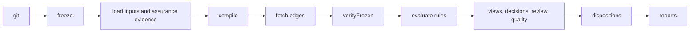

# How Concordia works

Concordia compares what the architecture says should be true with what the code, the manifests, and the signed records show. This page explains the parts and why they are built the way they are. To try it, see [Getting started](../tutorials/getting-started.md).

## Intent and observation

**Intent** is your architecture model, written in CALM 1.2 or 1.3. It lists nodes, the relationships between them, and controls. A policy pack adds rules about those nodes, such as "billing must not import from fulfillment internals".

**Observation** is a graph of your code. Concordia asks Codebase Memory (CBM) to index the repository, then reads the edges of that graph: which file imports which, which function calls which. The same graph holds infrastructure facts that the provider parses from committed manifests, such as which workload uses which image.

Neither side is trusted alone. The model can drift from the code, and the code cannot say what it was meant to do. A check puts them side by side.

A version number does not say what a provider extracts. A **capability profile**, tested against the pinned CBM build, states for each evidence family whether the build supports it, how stable it is, and which loss modes apply. The lock records the profile. An upgrade that removes a family shows up as a regression instead of as silently missing evidence. Native edges that Concordia cannot map to a canonical kind are kept as unsupported evidence with a diagnostic, so nothing is dropped without a trace.

The graph is one source of evidence among several. Rendered manifests, plans, signed statements, and reviews each come with a level and an integrity of their own, and a rule uses only the kinds that it permits. [Evidence and trust](evidence-and-trust.md) explains why.

## Bindings are the bridge

Observed edges connect code symbols. Rules talk about architecture nodes. A binding maps one to the other, for example "everything under `services/billing/` is the `billing` node". Once symbols are bound, each observed edge becomes an edge between architecture nodes, and rules can judge it. Code that no binding covers is simply invisible to the rules, which is why coverage matters (see [Verdicts and coverage](verdicts-and-coverage.md)).

Deployed things need a bridge too. Besides source, package, and name matches, a binding can match a `workload`, an `image`, a `route`, an `infraResource`, or a `composeService`, and the workspace declares the `environments` that the deployed resources belong to. A Deployment in `production` and the same Deployment in `staging` are two entities that can bind to one node.

## Obligations, not pairs

A rule with an `obligation` block does not judge a pair of nodes. Concordia expands it into one obligation for each subject and each environment from the architecture and the declared environments, before it reads the graph. An empty or partial graph therefore never removes an obligation. Each obligation is then judged against each evidence occurrence, such as each container. The reason is that a pair of nodes can have an allowed HTTPS connection and a forbidden administrative connection at once, and one result for the pair would hide one of them. See [Verdicts and coverage](verdicts-and-coverage.md#typed-obligations-one-result-for-each-occurrence).

## The pipeline

1. Concordia reads the git state and **freezes** it: the commit plus a digest of any uncommitted changes.
2. It loads the workspace, the CALM model, the binding set, the policy packs, the exceptions, and the assurance evidence, and validates them. Renders run, plans and statements are read, and each statement is admitted or rejected here, before any rule looks at it.
3. It resolves bindings and compiles the rules into a plan. Rules that contradict each other stop the run (`CO-POL-017`, exit 2).
4. It fetches the observed edges from the graph, normalizes them with scoped identities, and maps them through the bindings.
5. `verifyFrozen` checks that the repository still matches the freeze.
6. It evaluates every rule, giving each a verdict, with coverage recorded for each predicate. A `mandatory` rule whose guarantees are missing stops the run before any evaluation (`CO-POL-018`, exit 2), because a gate that cannot do its job must not report a result.
7. It adds the parts that are not edge rules, in this order: the diagram checks, ADR governance, review currency, and last the quality scenarios, which read the verdicts of the others.
8. It assigns each finding a disposition (active, baselined, waived, or expired-waiver).
9. It builds the deployment trace, the areas, the counters, and the result digest, and writes the reports and the run manifest. The manifest says `incomplete` until every file is written. A bundle is an optional export of the finished run.

Two ordering decisions matter. Evidence is admitted before rules run, so a rule never has to decide whether a statement is good enough: it sees only what passed admission, and a list of what did not. Quality scenarios run after review currency and the rules, because a `structural` scenario reads rule verdicts and a `reviewed` scenario reads review currency, and a verdict that depends on another must come after it.

## Why the graph is frozen

The graph is only meaningful for the exact code that was indexed. If you edit a file or switch branches between `index` and `check`, the edges describe code that no longer exists, and a green result would be a lie. So `check` verifies that the indexed state still matches the working tree. If not, it stops with `CO-OBS-008` (exit code 3) instead of reporting on stale data. The cost is that you must index again after the code changes; the benefit is that a verdict always refers to a known state.

## Canonical edge kinds and confidence

CBM reports relationships in its own vocabulary. Concordia maps them to a small set of canonical edge kinds, so policies do not depend on one tool's naming. Each edge also carries a confidence level, from `heuristic` up to `resolved` (`syntactic` sits between them; `runtime` and `unknown` also exist). Policies can require a minimum confidence; an edge below it is not strong enough to condemn code, which produces an `unknown` verdict rather than a guess. See [Policies](../reference/policies.md) for the kinds and levels.

## Identity of resources, images and facts

Infrastructure facts need identities that stay the same between runs and do not merge things that differ.

- A Kubernetes resource has a scoped ID, `k8s:<env>/<cluster>/<group>/<Kind>/<namespace>/<name>`. Parts that the manifest does not give, and a cluster that the workspace does not declare, are written `~`. The environment comes from the environment whose `sources` contain the manifest.
- An image is a repository with a tag or a digest. Two containers that use one repository at different tags are two occurrences, told apart by the container name (or the Dockerfile stage). The tag and digest come from the `image` property of the edge, never from the image node.
- An evidence fact is identified by its edge key: the canonical kind, the direction, the environment, the operation or protocol, the reference role, and the occurrence. Facts that differ in one part are two facts; the same fact seen twice counts once.
- Project-wide nodes (`Image`, `Route`, `EnvVar`) have no scope of their own. Concordia attributes facts to an environment through the scoped resource at the other end.

The provider can merge occurrences before Concordia sees them. When the capability profile of the CBM build states the loss mode `merged-occurrences` for a kind, every fact of that kind is marked possibly lossy. Concordia does not invent the occurrences it did not receive. `concordia explain` shows the identity of each evidence step, the lossy mark, and the profile loss mode; `graph/evidence.json` in an export bundle carries the same fields.

## What a result shows

A finding says what to do next, not only what is wrong. Besides the rule and the fingerprint it carries the condition that the rule expects, the evidence that was observed (or the gap, for an `unknown` result), the difference between the declared and the observed architecture when there is one, the limits of the provider for the evidence families that it depends on, and a next action from a fixed list: fix implementation, correct intent, resolve binding, supply evidence, regenerate view, get review, or fix analysis configuration. An obligation that is `unknown` has a finding too, with its reason, so a gap is never silent.

The report keeps its parts apart. `results.json` has one area for each part: `conformance`, `deploymentTrace`, `adrGovernance`, `diagramCurrency`, `assessmentCurrency`, and `qualityEvaluation`. Each has its own verdict and counts. A rule reports in the area of its pack, so the rules of the views pack report in `diagramCurrency`, the rules of the `adr-governance` pack in `adrGovernance`, and the rules of the `review-currency` pack in `assessmentCurrency`. The `deploymentTrace` area is filled from the trace and not from rules, and it never changes the exit code. An area that you do not use says `not-configured` and is never a pass, and a passing area cannot hide an area that is `unknown`: the summary verdict is the worst of them, and the terminal output names each area in its own section. The exit code stays a CI contract of its own: it counts only the rules and findings whose [enforcement mode](../how-to/run-in-ci.md#gate-by-environment) is `mandatory`.

The deployment trace shows how far Concordia can follow a service toward a cluster, and it is honest about the level. By default Concordia reads manifests and Dockerfiles as they are written: the **declared** level. When the workspace declares assurance evidence, an environment can also have the **rendered-or-evaluated** level: what a pinned Helm or Kustomize render of the committed sources gives, or what a plan would apply. That evidence sits next to the declared chain and never replaces a step of it. The other two levels, `deployment-execution` and `runtime-observation`, stay `not-available` in the trace. Signed deployment records and workload observations are judged through the claims `deployed-digest`, `deployment-succeeded`, and `runtime-drift`, and the trace text never says that a workload runs or that a deployment happened. A link from an image to a Dockerfile is a lineage candidate that a build command names. It is not proof that the image of a cluster came from that Dockerfile, and the trace says so in a limit. Only a verified build statement for the image digest gives exact lineage. Each step shows what supports it (declared intent, a parsed source fact, or an inferred association) and how firmly it is identified, and a gap says what evidence is missing. See [Deployment trace](../reference/results.md#deployment-trace) and [evidence and trust](evidence-and-trust.md).

Output is deterministic. For the same graph, policies, bindings, and workspace, findings, areas, coverage, and counters come in a fixed order and have the same values; only the run id, the timestamps, and the host differ. `summary.resultDigest` is the digest of the result without those fields, so two runs can be compared with one value. Counters (`ingestedFacts`, `unresolvedFacts`, `unsupportedFacts`, and the others) are plain numbers that show how much evidence a run read and how much of it Concordia could not use; they never contain text from your repository. See the [results reference](../reference/results.md#areas).

## Assurance evidence

The code graph and the declared level of the trace cannot say what a cluster receives, who built an image, or whether a test ran. The assurance adapters add evidence for that, and the workspace key [`assurance`](../reference/workspace.md#assurance) declares it. Without the key, Concordia reads none of it, and a rule that needs it is `unknown`.

- **Rendered manifests.** Concordia runs a pinned Helm or Kustomize itself, with confinement, and reads the output. The evidence is a function of the committed sources and the pinned renderer, and each render has a coverage (`complete`, `partial`, or `failed`). A resource set that is not complete never passes a rule that reads it.
- **Plans.** A Terraform or OpenTofu plan shows what would be applied. It is evidence of the rendered-or-evaluated level, never of a deployment.
- **Signed statements.** Builds, deployments, checks, and measurements are in-toto statements. Concordia verifies the signature with cosign against the producers that you declare, and compares the subject digest itself. A producer is trusted for the kinds of claim that you list and no others.
- **Provenance.** A verified build statement for an image digest, a builder and a source in your trust contract, a deployment record, and a workload observation give exact lineage and runtime drift. Concordia reads SLSA data and claims no SLSA level.
- **Evaluators.** The NetworkPolicy and RBAC evaluators compute an effective result from rendered manifests. Selection edges from the code graph are never evidence of isolation or access.
- **Claims and contracts.** A rule requires a claim, such as `exact-lineage`. A contract states what an adapter can establish, at which level, with which minimum integrity, and with which limits. A rule whose claim no loaded contract enables is `unknown` with the reason `claim-not-enabled`.

An obligation that lacks admissible evidence is `unknown`, never `pass`. The reason says what is missing: `no-evidence-supplied`, `rendered-evidence-missing`, `no-evaluator-available`, `enforcement-not-declared`, or `reviewed-mode-not-available`. Evidence that fails admission (a different revision, a stale time, a failed signature) is listed as detail with its reason, so you can fix it. This keeps a missing producer from looking like a clean system. [Evidence and trust](evidence-and-trust.md) explains the levels, the integrity ladder, and what the trust model does and does not cover. To declare the evidence, see [add stronger evidence](../how-to/add-stronger-evidence.md). For the contracts, the limits, and the reasons, see the [assurance reference](../reference/assurance.md#claims-and-contracts).

## Quality scenarios

A quality scenario states a response measure for a quality attribute, such as "p95 latency stays below 300 ms in production". It has one of three modes, and each mode reads a different kind of evidence.

- A `structural` scenario reads the verdicts of the rules that it names.
- A `measured` scenario needs an admissible signed measurement. Concordia compares the measured value with the criterion itself and never uses a verdict of the producer.
- A `reviewed` scenario reads the assessments of type `quality` that are current and approved.

A verdict holds for one scenario in its own mode: a `structural` pass never satisfies a `measured` scenario. Quality evaluation runs last because it reads the rule verdicts and the review currency of the same run. Its results report in their own area, `qualityEvaluation`, so a green conformance area cannot hide a mandatory scenario that is `unknown`. Concordia never says that an architecture meets a quality attribute in general, only that a scenario holds or does not hold. See the [quality section of the assurance reference](../reference/assurance.md#quality).

## Review currency

A review says that a design was acceptable once. Concordia asks whether the review is still about the system you have now. It reduces the facts that a reviewer relied on to dependency items with digests, compares the candidate with the subject that the approval bound (not with the previous commit), and reads the authority configuration from a trust anchor, so a candidate cannot approve its own relaxation. The result is `current`, `review-required`, `expired`, `revoked`, or `unknown`. A change is a reason to ask a person to look again. It is never a statement that the system is vulnerable or compliant. [Review currency](review-currency.md) has the dependency items, the digest contract, and the traversal.

## The bundle

`export bundle` packs the results, the run manifest, and the evidence files into an archive with a digest for each file, so that another person can check what the run said. `export verify` checks the digests and prints `content verified by digest`. A digest shows that the content did not change after export, not who made the bundle. A signature that you verify with `--verify-signature` raises the level to `producer authenticated`. Redaction removes values that look like secrets before Concordia prints or stores any text, and the manifest records each removal by place and class, never by value. See the [redaction reference](../reference/redaction.md) and [run Concordia in CI](../how-to/run-in-ci.md#share-bundles-safely).

## How views stay current

A declared architecture view can go wrong in four independent ways, and Concordia checks each one on its own: the file is **present** in the tracked revision, it is **fresh** (a generated file equals what Concordia generates now), it **corresponds** to the architecture and the implementation, and any review that covers it is **current**. A pass of one check never changes another. A timestamp is never evidence of freshness.

Freshness and the stability of a review both depend on one question: did the architecture that the view shows change? Concordia answers it with two digests that it keeps apart.

- The **artifact digest** is the SHA-256 of the bytes of the committed file. A layout change, a color change, or a new auto-layout changes it, because the bytes changed.
- The **semantic digest** is the SHA-256 of a canonical, versioned description of what the view means. It does not read the file.

The semantic digest covers the **model projection** and the **observed projection** of the view, and the slice of the bindings, controls, and policy rules that select a depicted element. The model projection holds the elements of the scope at the abstraction level of the view and the declared relationships between them, with kind, protocol, direction, and explicit `null` for a value that is not there. For a deployment view it also holds the placement of one environment. The observed projection rolls the observed edges up, by binding and by containment, to the same elements, merges parallel edges by kind and protocol, and lists an entity that more than one element claims as ambiguous with its candidates, without guessing. Edges with an unbound end are not relationships: the projection records that elements of the view have unbound neighbors, and it records a necessary element that no entity binds to as lost coverage, so a projection never becomes smaller by design without saying so.

What the digest leaves out is as important. It does not contain layout, colors, timestamps, names and descriptions (unless the view lists them in `projection.semantic`), source lines, edge counts, or function bodies, and it does not contain a policy rule, a control, or a binding that does not select a depicted element. An internal refactor, a new call between two functions of one container, a rewording, or an edit of an unrelated rule therefore leaves the digest unchanged, and the manifest of the view stays valid. The digest does contain the scope, the abstraction level, identities, direction, protocol, the necessary coverage, and the digest and projection contract versions. A change of a contract version is never absorbed: the manifest becomes stale with `contractChanged`, and every view is regenerated on purpose.

The expected effect of each kind of change follows. Each row names the test that holds it in `internal/views`.

| Change | Semantic digest | Test |
| --- | --- | --- |
| Internal refactor, with no dependency change between elements | Unchanged | `TestSemanticDigestA15FunctionBodyChangeLeavesDigestEqual` |
| New database dependency | Changes, so the related views need regeneration or correction | `TestSemanticDigestNewDatabaseDependency` |
| New workload identity | Changes, in the deployment view | `TestSemanticDigestNewWorkloadIdentity` |
| Move to another environment | Changes, in the view of each environment | `TestSemanticDigestEnvironmentMove` |
| Layout or color edit only | Unchanged, while the artifact digest changes | `TestSemanticDigestLayoutAndColorEditChangesTheArtifactOnly` |
| Authorization code changes, topology does not | Unchanged: the view stays current, while a dependent review can still need a new evaluation | `TestSemanticDigestAuthorizationCodeChangesTopologyDoesNot` |
| Coverage or binding removed | Changes: the view does not stay current because the projection shrank | `TestSemanticDigestBindingRemovedIsNotKeptCurrent` and `TestObservedProjectionLostCoverage` |

Two more cases follow from the same rules. A protocol change of a depicted relationship (`HTTPS` to `gRPC`) changes the digest (`TestSemanticDigestProtocolChange`), and an edit of a policy rule that selects no depicted element does not (`TestSemanticDigestUnrelatedPolicyEditLeavesDigestEqual`).

## How the decision history picks an active decision

An architecture decision is replaced over time, and the files say so in two places: a statement such as "supersedes ADR-0003" and a `superseded_by` line in the replaced ADR. Concordia reads both and builds one history, successor to predecessor. It never decides which of two competing ADRs is "the real one".

Three rules keep the history honest.

- **The path is the identity.** The ID in a title is a label. Two files with the same number are two decisions, and a file that moves keeps the ID that your register gives it. A `superseded_by` value is link text, so Concordia resolves it as a path relative to the file that holds it, and reads a bare ID only when the value cannot be a path. A target that is not a committed ADR, including one that points outside the project, is reported and never followed.
- **Only an active successor replaces.** A `proposed` or `draft` ADR that says it supersedes another is a pending link: it is shown, and the older decision keeps its own status. When an accepted successor exists but the older ADR still says `Accepted`, the older decision is superseded and the report notes that its status text lags.
- **Any contradiction makes the whole connected set ambiguous.** A cycle, a missing target, two files with one ID, a `superseded` ADR with no successor (or a rejected one), and two successors that do not supersede each other each give a finding. Every registered decision in that set is `ambiguous`, and its result is `unknown`, so the default `check.unknown` blocks the run until a person fixes the ADRs. A later date or a higher number does not break the tie, and an unrelated set of decisions is not affected.

The history has one limit that comes from the provider. CBM 0.12.1 does not show a "supersedes X" statement when X is not a committed ADR, so that mistake is invisible; only a `superseded_by` value that points to nothing can show a missing target. The report states this limit instead of hiding it. The [ADR governance reference](../reference/adr-governance.md#supersession-history) lists the normalization rules and the reasons.

## Why a decision has three separate states

Concordia treats an architecture decision as a supporting entity: it is evidence that justifies a rule, never a rule itself and never a replacement for the architecture. What a decision governs and which rules enforce it come only from a committed register that your team writes. The ADR text supplies facts (title, status, supersession), and Concordia treats it as data.

Each registered decision therefore has three states, and none implies another.

- **Presence.** Is the ADR file committed in the evaluated revision, and does the indexed text equal it? A decision that only the code index knows about does not count.
- **Applicability.** Is the committed decision in force? It is `active`, `inactive`, `superseded`, `ambiguous` (the history above contradicts itself), or `unknown` (the facts are not committed or not verifiable).
- **Enforcement.** Does a mandatory rule that the register links enforce it? A decision can be committed and active and still `unlinked`.

Keeping them apart stops a good state from hiding a bad one: an active decision without a committed file, or a committed decision that no rule enforces, each shows its own result. When a decision is superseded, Concordia does not move its governance to the successor. It lists the successor as a candidate, and a person edits the register, because the choice of what the new decision takes over is the review. See the [ADR governance reference](../reference/adr-governance.md#presence) and [govern architecture decisions](../how-to/govern-architecture-decisions.md).

## Why Concordia never reads the CBM database

The CBM database layout is an implementation detail of that tool. Concordia talks to CBM only through its command interface, and records the adapter and CBM versions in each result. A CBM upgrade that changes storage cannot silently change your verdicts; an incompatible version is reported as a toolchain problem instead.

## How the baseline gaps map to this extension

The [evidence baseline report](evidence-baseline-report.md) lists the gaps of the as-built evidence model. Each gap has one place in the pipeline above:

- **Observation.** Native edge kinds that the adapter table does not map are only counted, and `IMPORTS`, `USAGE`, and `CONFIGURES` each merge several meanings into one canonical kind. The extension keeps all native evidence and gives each meaning its own kind.
- **Bindings.** Only source, package, and name matches exist, so a deployed resource cannot bind to the architecture. The extension adds binding kinds and environments for deployed resources.
- **Reconciliation and evaluation.** Edges with an unbound or missing endpoint are skipped, and one relationship can permit a whole pair of nodes. The extension counts every skipped fact and evaluates each occurrence.
- **Coverage.** Coverage is a file measure and the provider lists supported kinds only. The extension makes coverage specific to each predicate and records known loss modes.
- **Version gate.** The CBM gate is a version range. The extension replaces it with a tested capability profile.
- **Reporting.** A finding has no expected condition, no provider limits, and no next action, and the report has one verdict. The extension adds the fields to each finding, a separate result for each report area, counters, and a digest of the result.

## Related

- [Evidence and trust](evidence-and-trust.md)
- [Verdicts and coverage](verdicts-and-coverage.md)
- [Review currency](review-currency.md)
- [Fingerprints, baselines, and waivers](fingerprints-baselines-waivers.md)
- [Evidence baseline report](evidence-baseline-report.md)
- [Add stronger evidence](../how-to/add-stronger-evidence.md)
- [Assurance reference](../reference/assurance.md)
- [Results reference](../reference/results.md)
