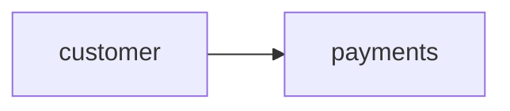
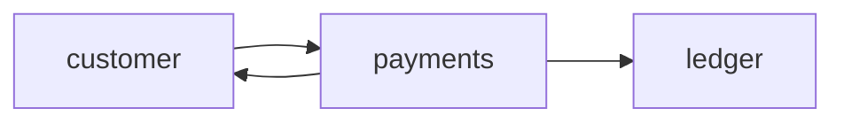

# How to keep diagrams current

This guide shows you how to declare an architecture view in the workspace, generate it or write it yourself, commit it, and have `concordia check` tell you when it is out of date or no longer matches the architecture. The example is the workspace in `test/fixtures/views` in the Concordia repository: a payments system with an orders service and a database, one generated view, and one authored view.

## Prerequisites

- A workspace with a CALM architecture that passes `concordia model validate`. See [set up a workspace](set-up-a-workspace.md).
- A Git repository with at least one commit. Concordia reads the committed revision, not the working tree.
- An index of the project (`concordia index`).
- For an authored Mermaid view: CBM index mode `full`, set with `observation.indexMode: full` in `concordia.yaml` (the fixture does) or with `concordia index --mode full`. CBM emits diagram evidence in this mode only. In another mode, the correspondence of an authored Mermaid view is `unknown` with the reason `structure not available`.
- For exports (`mermaid`, `plantuml`, `dot`, `json`): the Structurizr CLI version `2025.11.09`. See [install Structurizr through Docker](render-diagrams.md#install-the-structurizr-cli-through-docker) and [the pinned version](render-diagrams.md#the-pinned-version-and-confined-rendering).

## Declare a generated view

A view is an entry of the `views` list in `concordia.yaml`. A generated view says what it shows and where Concordia writes it:

```yaml
views:
  - id: payments-container
    kind: container
    origin: generated
    owner: team-payments
    scope: [payments-system]
    abstraction: container
    environment: staging
    coverage:
      elements: [orders-service, payments-db]
      relationships: [orders-to-db]
    output:
      path: docs/architecture/views/payments-container.dsl
      exports:
        - format: mermaid
          path: docs/architecture/views/payments-container.mmd
    comparison:
      against: [declared, observed]
      severity: warning
```

- `id` is the only durable identity of the view. It becomes the key of the Structurizr view and the name in every result. Do not rename it: waivers and baselines refer to it.
- `scope` lists the CALM nodes that the view is about, and `abstraction` is the level at which it is compared. `kind` and `abstraction` go together (`container` with `container`). The `coverage` lists the elements and relationships that the view must show; without it, every element of the scope at that level and every declared relationship between them is necessary.
- `output.path` is the committed file. It must be inside the workspace, must not be under `projection.output` (`build/concordia/` by default, which `init` puts in `.gitignore`), and must not match a Git ignore rule. `concordia model validate` reports a path that breaks one of these with `CO-DGM-002` and exit code 2.
- `output.exports` lists the committed export files. Each needs the pinned Structurizr CLI.
- `comparison.severity: warning` lets the first runs report a difference without failing `check`. Raise it to `error` when the view is stable.

The [workspace reference](../reference/workspace.md) lists every key and its default.

Check the definition:

```bash
concordia model validate
```

## Render the view

```bash
concordia index
concordia render --views
```

`render --views` runs the check pipeline, then writes these files for each generated view:

| File | Content |
|---|---|
| `docs/architecture/views/payments-container.dsl` | The Structurizr DSL of the view. |
| `docs/architecture/views/payments-container.mmd` | The Mermaid export, made by the pinned CLI. |
| `docs/architecture/views/payments-container.dsl.manifest.json` | The manifest: the digests of the inputs and of each artifact, the generator and its version, and the revision that the view was made from. It has no timestamp. |

The files do not depend on the time of the run. Two runs on the same inputs write the same bytes, so a second run changes nothing. The DSL has no waiver, baseline, or finding state, so a change of a disposition does not change a committed view. To write one view only, use `concordia render --views --view-id payments-container`.

If a definition or an output path is not valid, the command stops with exit code 2 before it writes any file. If the CLI is missing or is another version than the pin, it stops with exit code 5 and writes no file. The [CLI reference](../reference/cli.md#render---views) lists the exit codes.

## Commit the files

```bash
git add docs/architecture/views
git commit -m "docs: render the payments views"
```

Commit before you run `check`. Presence and freshness read the files of the committed revision. A file that exists only in your working tree is `not committed`, and a diagram that only the code index knows about does not count either.

## Check that the view is current

```bash
concordia check
```

`check` never writes a view file. For each declared view it gives four separate results:

- **Presence**: the artifact, the exports, and the manifest are in the committed revision, and the manifest names this view and this scope.
- **Freshness**: Concordia recomputes the digests of every input, regenerates the DSL and the exports in a confined run, and compares bytes and digests. A manifest that only repeats recorded digests never gives a pass, so a manifest that you edit by hand does not hide a stale artifact.
- **Correspondence**: the diagram shows the relationships of the declared model and, if `against` includes `observed`, those of the code. A generated view always equals the declared model; a difference with the code shows even when the view was regenerated.
- **Assessment currency**: informational. When the workspace has [assessments](review-and-approve-assessments.md) that cover the subject of the view, the entry lists them and the worst currency state (`revoked`, `expired`, `review-required`, `unknown`, or `current`). Otherwise it is `not-evaluated`. It never changes the verdicts of the other three checks.

A relationship that you change in the CALM file, a changed protocol, a new binding, or a new rule that selects a depicted element changes the digests. The view is then stale.

A passing run on the fixture prints one row for each view:

```text
Diagram presence, freshness, and correspondence: pass (5 pass, 1 notApplicable, 2 views)
  payments-container (container, generated): presence: pass, freshness: pass, correspondence: pass (method: generated-source), assessment currency: not-evaluated
  payments-context (system-context, authored): presence: pass, freshness: not-applicable, correspondence: pass (method: structured-source), assessment currency: not-evaluated
```

To see a stale view, change the protocol of the relationship `orders-to-db` in `architecture/payments.calm.json` from `TCP` to `HTTPS`, commit the change, and run `concordia index` and `concordia check` again. Freshness is now a `violation`, with the reasons `artifact differs from the regenerated bytes` and `input digests differ` (`modelProjection` and `semantic`), and the next action is `regenerate view`. The view has `severity: warning`, so `check` prints the findings and exits with code 0. With the default severity `error`, it exits with code 1. Render the view again and commit the result:

```bash
concordia render --views --view-id payments-container
git add docs/architecture/views
git commit -m "docs: regenerate the payments container view"
```

Changes that do not change the architecture leave the semantic digest alone: a function body, a method call inside one container, layout, colors, and a rule that selects no depicted element. The committed files change only when the generated bytes change.

The manifest records the revision that it was made from. A new commit therefore changes the manifest of the next render, even when no input of the view changed. `check` does not compare revisions, so you do not need to render only because you committed.

## Fix a result that is not a pass

| Result | Reason | What to do |
|---|---|---|
| Presence `violation` | `not committed`, `missing`, `view ID mismatch`, `scope mismatch` | Run `render --views` and commit the files (generated view), commit the source file (authored view), or correct the path or the ID in the definition. |
| Freshness `violation` | `input digests differ`, `artifact differs from the regenerated bytes`, `digest contract changed` | Run `render --views` and commit. After a Concordia release that changes a contract, every view needs this once. |
| Freshness `unknown` | `generator cannot run`, `include not available`, `no tracked revision` | Install the pinned Structurizr CLI, make the allowed include readable, or run in a Git repository with a commit. |
| Correspondence `violation` | `missing relationship`, `extra relationship`, `incorrect relationship`, `unmapped element` | Correct the diagram or the architecture; see [read the result of an authored view](#read-the-result-of-an-authored-view). |
| Correspondence `unknown` | `structure not available`, `mapping gap`, `ambiguous mapping`, `no binding for necessary element` | Index in mode `full`, add the mapping key, or add the binding that the diagram needs. Next action `supply evidence` or `resolve binding`. |
| Correspondence `unknown` | `raster image without supplemental mapping`, `supplemental mapping stale` | See [diagrams that are images](#diagrams-that-are-images). |

## Declare an authored view

An authored view is a diagram that people write, in a Markdown file with a Mermaid block or as an image. Concordia does not generate it. It checks that the file is committed and that the diagram shows the architecture. The fixture declares one:

```yaml
views:
  - id: payments-context
    kind: system-context
    origin: authored
    owner: team-payments
    scope: [payments-system]
    abstraction: system
    source:
      path: docs/arch/payments.md
      format: mermaid
      selector:
        title: Payments context
    mapping:
      elements:
        customer: customer
        payments: payments-system
```

The diagram is the Mermaid block under the heading `Payments context` in `docs/arch/payments.md`:

````markdown
## Payments context


````

- `source.path` and `source.format` name the committed file and its format: `mermaid`, `plantuml`, `dsl`, `png`, `jpeg`, or `gif`. Only Mermaid has structured evidence in this release.
- `source.selector` picks the diagram block with `title` (the heading above the block) or `anchor`. An index or a provider ordinal is not accepted (`CO-DGM-001`), because a new block above yours would renumber it. A selector that matches more than one block gives `unknown` with the reason `diagram selector is ambiguous`.
- `mapping.elements` maps each element of the diagram to a CALM node. The key is the node ID that you wrote in the Mermaid source (`customer` and `payments` in `customer --> payments`), not the label. The value is a CALM node ID; an ID that the model does not have is `CO-DGM-001`.
- An authored view has no `output` and no manifest, so `render --views` writes nothing for it. `render --views --view-id payments-context` gives `CO-WRK-010`.
- `comparison.against` selects what the diagram is compared with: `declared`, `observed`, or both (the default).

Index in mode `full` and check:

```bash
concordia index
concordia check
```

`concordia model validate` checks the definition and the mapping values against the model first.

## Read the result of an authored view

For the view `payments-context`, `check` gives these results:

- **Presence** is `pass` when the source file is in the committed revision. A file that exists only in your working tree gives `violation` with the reason `not committed`.
- **Freshness** is `not-applicable`. There is nothing to regenerate. The result records the digest of the source in `freshness.artifacts[].digest`.
- **Correspondence** has the method `structured-source`. Concordia reads the elements and arrows from the diagram evidence that CBM keeps. It does not parse the Mermaid text, and it does not follow a link or run a click handler in the diagram. Each arrow is compared with the relationships of the model at the abstraction of the view, so an arrow between `customer` and `payments` is the relationship between `customer` and `payments-system`.

A diagram at container level shows no methods. Method-level calls inside one container are not drift, and the result lists no omission for them.

To see a difference, change the diagram block in `docs/arch/payments.md` so that it has an arrow in the wrong direction and an element that no mapping names:

````markdown

````

Commit the file, then run `concordia index` and `concordia check`. The exit code is 1. The correspondence of `payments-context` is a `violation` with two findings, each with the location of the line and the next action `correct intent`:

| Line | Difference | Meaning |
|---|---|---|
| 8 | `extra` relationship from `payments-system` to `customer` | The diagram shows an arrow that neither the model nor the code has. |
| 9 | `unmapped` element `ledger` | The diagram has an element that no `mapping.elements` key names. |

The other differences are `missing` (the model or the code has a relationship that the diagram lacks, with `basis: declared` or `observed`) and `incorrect` (the same ends with another direction, kind, or protocol). Correct the diagram, add the mapping, or correct the architecture if the diagram is right. Concordia never decides which one is wrong. Restore the block of the fixture before you go on, and commit it.

Concordia never guesses. A diagram element that two mapping keys or two labels could match, a necessary element that has no mapping, a necessary element that has no binding in the observed graph, or a diagram that CBM gave no structure for gives correspondence `unknown` with the reason. It is not a pass. See [resolve unknown verdicts](resolve-unknown-verdicts.md).

## Diagrams that are images

CBM does not index PNG, JPEG, or GIF files. Presence and the digest of an image come from Git alone, and Concordia cannot read the arrows of an image.

- Without `mapping.depicts`, the correspondence method is `presence-only` and the correspondence is `unknown` with the reason `raster image without supplemental mapping`. No automated pass is possible.
- With `mapping.depicts`, you claim what the image shows, and bind the claim to the digest of the committed image. The method is `supplemental-mapping`, and Concordia compares the claim with the model.

Add an image view to the fixture. Any PNG works; this writes a small one:

```bash
mkdir -p docs/arch
base64 -d > docs/arch/context.png <<'EOF'
iVBORw0KGgoAAAANSUhEUgAAAAEAAAABCAYAAAAfFcSJAAAADUlEQVR42mP8z8BQDwAEhQGAhKmMIQAAAABJRU5ErkJggg==
EOF
sha256sum docs/arch/context.png
```

Declare the view in `concordia.yaml`, with the digest that `sha256sum` printed (prefixed with `sha256:`):

```yaml
  - id: payments-context-image
    kind: system-context
    origin: authored
    owner: team-payments
    scope: [payments-system]
    abstraction: system
    source:
      path: docs/arch/context.png
      format: png
    mapping:
      depicts:
        digest: sha256:<digest of the image>
        elements: [customer, payments-system]
        relationships: [customer-uses-orders]
```

Commit the image and the workspace file, and run `concordia index` and `concordia check`. The correspondence of the image view is `pass` with the method `supplemental-mapping`. Remove the `mapping` key and it is `unknown` with the method `presence-only`, and `check` exits with code 4 while `check.unknown` is `fail` (the default).

When someone replaces the image and does not update the digest, the claim is stale: correspondence is `unknown` with the reason `supplemental mapping stale`, and the next action is `supply evidence`. Look at the new image, correct `elements` and `relationships` if they changed, and write the new digest. The claim is only as good as the person who looked at the image: Concordia checks the claim, not the picture.

## Adopt views in shadow mode

A first run on an existing repository reports differences and unknowns that nobody has looked at. Keep them from blocking until the views are stable:

- Set `comparison.severity: warning` on each view. A finding of a view takes this severity, and `check.failOn` (default `error`) lets a warning pass. Raise the severity per view to `error` when the view is stable.
- Set `check.unknown: warn` in `concordia.yaml`, so an `unknown` correspondence does not give exit code 4. The pretty output then prints `On unknown: warn`.
- To keep the view findings out of the exit code and still show them, give the family an enforcement mode:

  ```yaml
  check:
    unknown: warn
    enforcement:
      - {family: view-currency, mode: advisory}
  ```

  `advisory` findings are shown (SARIF level `note`) and never count. `shadow` records them in `results.json` and hides them from the other reports. See [run in CI](run-in-ci.md#gate-by-environment).

Baselines and waivers work for view findings as for any finding. The fingerprint depends on the rule, the view ID, the subject, the kind of difference, and the path. It does not depend on a digest, a timestamp, or the order of the diagram blocks, so a regenerated view keeps its identity. Renaming a view changes it.

## Read the results

`check` writes the view results to `build/concordia/results.json`. The area `diagramCurrency` has the worst verdict of all checks of all views and the counts:

```bash
jq '.areas.diagramCurrency' build/concordia/results.json
```

The `views` array has one entry for each declared view, sorted by view ID, with the verdict and the details of each check:

```bash
jq '.views[] | {id, nextAction, presence: .presence.status, freshness: .freshness.status, correspondence: .correspondence.status, method: .correspondence.method}' build/concordia/results.json
```

The findings of the views have the area `diagramCurrency`. Their kinds are `view-absent` (presence), `view-stale` (freshness), and `view-drift` (correspondence), under the rules `VIEW-PRES-001`, `VIEW-FRESH-001`, and `VIEW-CORR-001`:

```bash
jq '.findings[] | select(.area == "diagramCurrency") | {ruleId, kind, severity, nextAction, location}' build/concordia/results.json
```

The rules are built in. You do not list them in `policies.packs`. The family for `check.enforcement` is `view-currency`.

The pretty output shows the area as `Diagram presence, freshness, and correspondence`, with one row for each view. A passing `conformance` area never hides a view that is `unknown`: the line `Unknown area(s): Diagram currency` names it. `--format junit` has one test suite for each check of each view, named `views/<view id>/<check>`. `--format sarif` points each finding to the declared source of an authored view, or to the output file of a generated view, and lists the views in the run properties. `export bundle` adds the manifest, the projection, and the artifacts of each view. The [results reference](../reference/results.md#views) lists every key.

The next actions are `regenerate view` (freshness, or presence of a generated view), `correct intent` (a difference), `resolve binding`, `supply evidence` (an authored source, a mapping, or an image), and `fix analysis configuration` (the toolchain or the coverage).

To run these checks in a pipeline that the branch under test cannot change, see [verify views from a protected pipeline](run-in-ci.md#verify-views-from-a-protected-pipeline).

## Next steps

- [Render diagrams](render-diagrams.md): the formats, the pinned CLI, and the confinement limits.
- [Results reference](../reference/results.md#views): the `views` array, the `diagramCurrency` area, and the finding kinds.
- [Run in CI](run-in-ci.md#verify-views-from-a-protected-pipeline): the trust model of `check`.
- [CLI reference](../reference/cli.md#render---views): the flags, the files, and the exit codes of `render --views`.
- [Workspace reference](../reference/workspace.md): the `views` keys and `projection.allowIncludes`.
